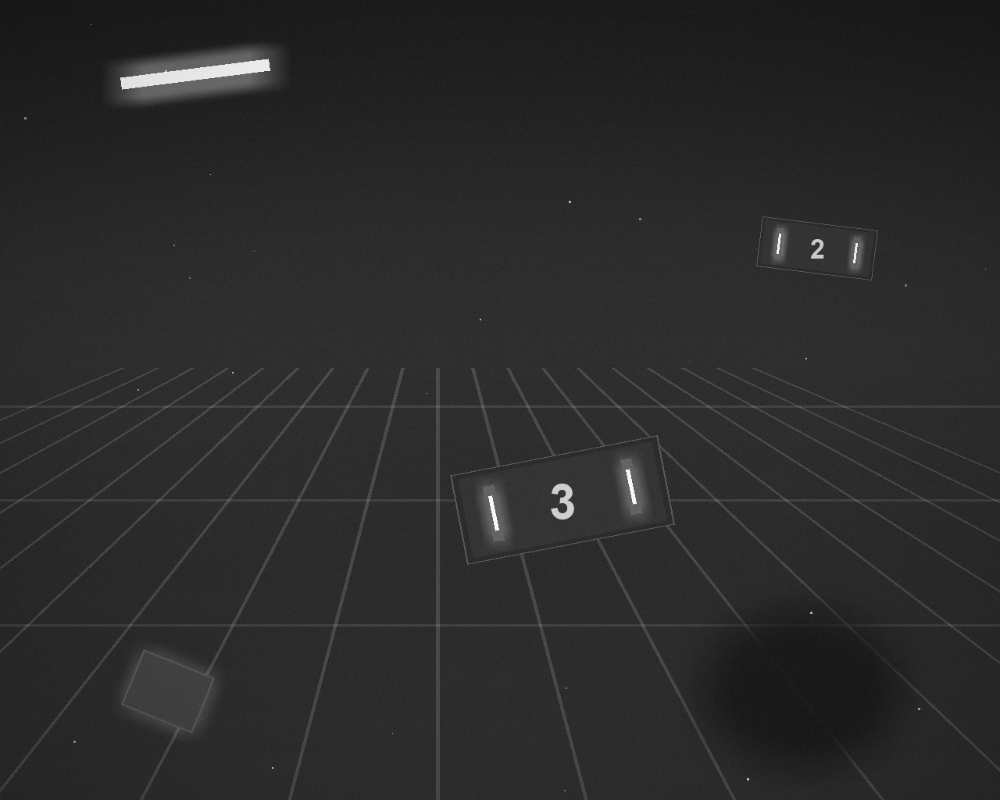
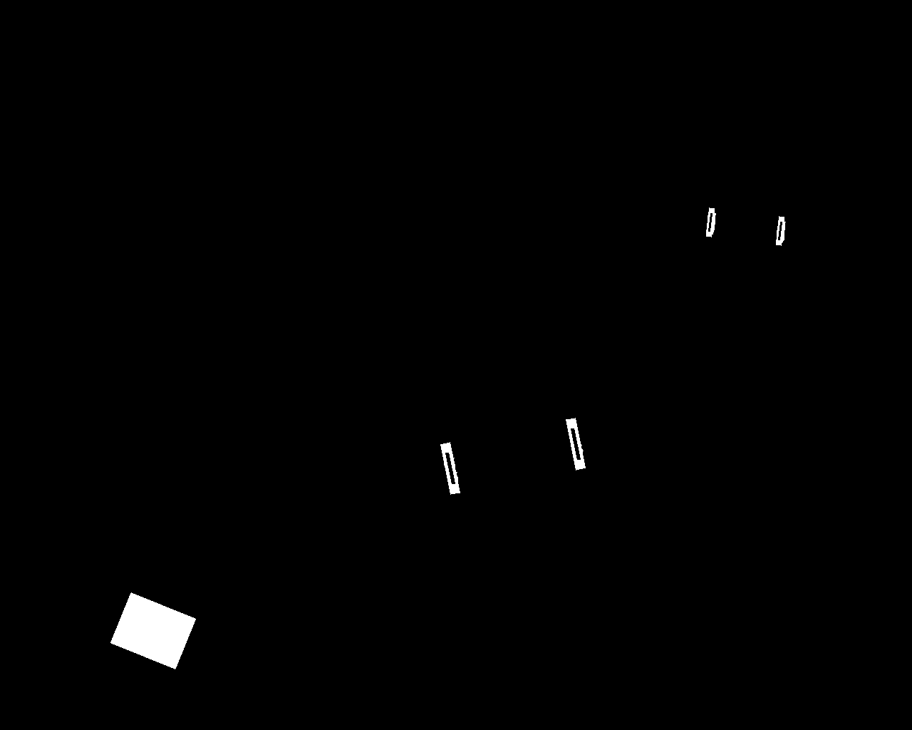
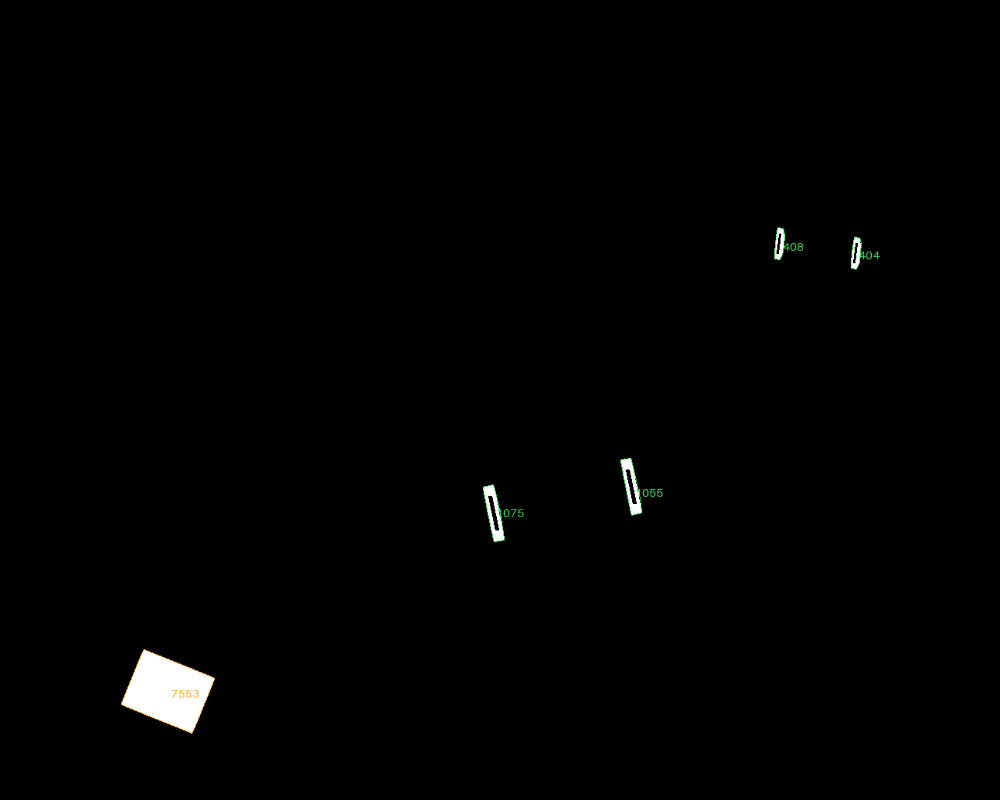
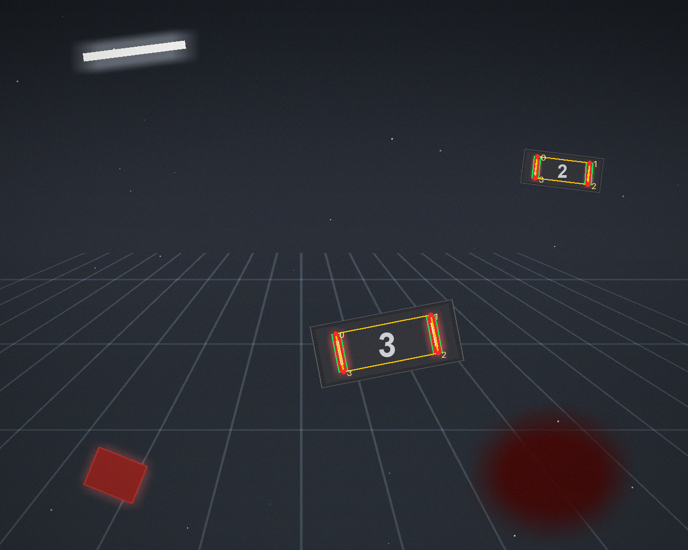

# RM 算法组培训 · 第一讲 计算机视觉

战队算法组培训（第一讲 · 计算机视觉）的学习记录：笔记、练习源码、运行结果。

> 一句话：这一讲讲的是「一张图怎么一步步变成四个像素坐标」——从成像、数据表示、颜色分割、形态学、轮廓几何，最后把两根灯条配成一块装甲板。

---

## 目录导航

| 文件 | 内容 |
| --- | --- |
| [notes/01-computer-vision.md](notes/01-computer-vision.md) | 第一讲完整学习笔记（分节对齐讲义，含自己的疑问） |
| [code/light_bar_detect.cpp](code/light_bar_detect.cpp) | 灯条检测练习：C++17 + OpenCV 版 |
| [code/CMakeLists.txt](code/CMakeLists.txt) | 上面那个 C++ 程序的构建脚本 |
| [code/light_bar_detect.py](code/light_bar_detect.py) | 同一套流水线的纯 numpy + Pillow 复刻（本机没装 OpenCV 时用） |
| [code/make_demo_image.py](code/make_demo_image.py) | 生成模拟测试图 `code/demo_board.png` |
| [results/](results/) | 各阶段结果图与运行日志 |
| [docs/00-environment.md](docs/00-environment.md) | 开发环境准备：C++/CMake/git、OpenCV、ROS2 Humble 与验证命令 |
| [.gitignore](.gitignore) | 忽略构建产物、缓存、IDE 配置 |

---

## 第一讲知识地图

### 1.1 算法组？视觉组？

- 本质是同一批人的两种叫法。**视觉组**强调走计算机视觉这条路线，**算法组**强调负责范围更宽（感知、估计、决策）。
- 名字变化的背景是规则、机器人功能、队伍水平都在演进，不是计算机视觉过时了，也不是谁更高级。

### 1.2.1 什么是计算机视觉

- 没有全学科唯一排他的定义，讲义引了三个权威来源：CS231A（工具与理论 + 解释世界）、IEEE Technology Navigator（学科归属 + 从视觉输入提取有意义信息）、Szeliski（用计算方法推断、描述、重建世界及其属性）。
- **共性**：都从视觉观测里拿有用信息，用于分析、推断、理解。
- **差异**：CS231A 侧重工具与理论，IEEE 侧重学科定位，Szeliski 侧重计算方法与「重建世界属性」这个目标。

### 1.2.2 研究什么

- **视觉观测的形式**：图像（某一时刻的二维信息）、视频（帧序列，多了时间维度）、深度图（深度的定义随传感器而变）、其他（双目、多光谱等）。
- **图像在计算机里就是数表**：1280×1024 的彩色图 = 1280×1024×3 个 0~255 的数。数表本身没有「装甲板」「数字 3」「红色」这些概念。
- **图像不是现实世界**，而是现实世界经过观测与成像之后的一份数据表示——观测过程会丢信息。
- **目标信息的层次**：是什么（识别）→ 在哪里（图像坐标）→ 多远（三维位置）→ 什么姿态（位姿）→ 怎么动（多帧观测）。
- **典型任务**：分类、检测、分割、关键点、深度估计、位姿估计、跟踪、三维重建，彼此不严格互斥。

### 1.3 在 RoboMaster 里的位置

- 自瞄链路：图像与采集时间 → 检测 → 位姿解算 → 坐标变换 → 跟踪与状态估计 → 瞄准与开火判定 → 通信给电控。
- 本讲只做第一环**检测**，输出是灯条四个角点的像素坐标 + 时间戳。点不准，后面全歪。

### 2.1 成像

- 光 → 镜头 → 传感器在有限面积与曝光时间内积分 → 数字化 → 颜色重建 → 数组。
- 同一物体不对应固定像素值；镜面反光能比灯条更亮。
- 焦距决定视场与像素尺度；对焦是清晰物距范围（不是变焦）；光圈数越小进光越多、景深越浅。
- 曝光是积分，所以有拖影：`拖影长度 ≈ v · t`，1000 px/s × 5 ms ≈ 6 px，十几个像素宽的灯条已经很敏感。
- 增益不增加光子；拉长曝光画面更亮但会过曝（红灯条中心趋白、蓝灯条中心偏青）。滚动快门会带来倾斜弯曲，换全局快门能消畸变、消不掉模糊。

### 2.2 数字图像基础

- 原点在左上角，x 向右、y 向下，整数坐标从 0 开始；`(x, y)` 就是第 y 行第 x 列。
- 灰度 1 通道、彩色 3 通道；OpenCV 读彩色是 BGR；8 位无符号 0~255（`CV_8UC3` / `CV_8UC1`）。
- 1920×1080×3 ≈ 6.2 MB，还要算行步长与对齐；二值掩膜也是每像素 1 字节。压缩文件大小是另一回事。
- 颜色是重建的：单感光单元只测一种分量，Bayer 2×2 里 2 绿 1 红 1 蓝，靠去马赛克补齐。RGB/BGR 搞反不会报错，只会悄悄把红当蓝——要用已知颜色对象验证通道数值。
- 上游还有白平衡、颜色校正、gamma、降噪、锐化、压缩（H.264 / YUV420）。
- ROI 省算力、排干扰，但 ROI 内坐标以 ROI 左上角为原点，回原图要加偏移；有缩放要先还原缩放。

### 2.3 颜色差与阈值

- 只按亮度筛不行：灰度 > 200 的像素里，白色灯管框内有 3051 个，灯条框内只有 432 个。
- 判据改成**通道差**：红色分数 `max(R − B, 0)`（蓝色目标用 `B − R`）。
- 掩膜 = 颜色差 > 60 **且** R > 100。注意灯条中心接近白色，掩膜出来是**空心框**。
- 阈值不是越高越好：阈值 140 时前 300 帧只有 125 帧能出候选。单帧成功 ≠ 参数可靠。

### 2.4 形态学

- 3×3 方形结构元素；腐蚀 = 全覆盖才保留，膨胀 = 有交集就点亮。
- 开 = 先腐后膨（去小前景、断细连接），闭 = 先膨后腐（补缺口、连邻近）。
- 本例的空心框两侧只有 2 px 宽，开运算把左灯条切成 32 px 和 19 px 两段，直接导致配不成对；**闭运算**能保住连接，所以基线用闭运算。
- 形态学负责让区域成形、连通，几何筛选负责判断像不像灯条，两者别混着调。

### 2.5 轮廓与几何

- 8 邻域；只取外轮廓，不保留孔洞，所以空心与实心可能有相同外轮廓。
- 轮廓只是边界点集，没有语义。
- `minAreaRect` 给出中心、长边、短边、长轴方向；端点 `上 = c − u·l/2`、`下 = c + u·l/2`，是**长轴端点**，不是两条长边的中点。
- 轮廓面积 ≠ 前景像素数（合成例：891 个像素，轮廓面积 800）。
- 筛选：面积 ≥ 20、长度 ≥ 6、长宽比 ≥ 2、偏离竖直 ≤ 35°。这些阈值依赖图像尺寸、距离、分割方式，不是装甲板的普遍定义。

### 2.6 灯条配对

- 长度比 ≤ 1.5；高度差比 `|Δy| / 平均长度` ≤ 0.35；间距比 `中心距 / 平均长度` ∈ [0.8, 3.2]；两长轴夹角 ≤ 15°。
- 用平均长度归一化能让条件在缩放时近似不变，但透视、转角、检测误差仍会影响，**不能说不受距离姿态影响**。
- 四端点按序连成四边形，面积 ≥ 1 px² 排除退化。
- 点位顺序：0 左灯条上端、1 右灯条上端、2 右灯条下端、3 左灯条下端，是灯条长轴端点（不是金属板四角）。

### 2.7 失败分析

- Red_5000 第 668 帧：高度差比 > 0.35 被配对条件拒绝。只放宽到 0.5 能救这一帧，但会引入更多错误组合。
- 排查要按阶段看实际输出：输入 → 颜色分数 → 掩膜与连通结构 → 灯条筛选与配对拒绝原因。日志要留被拒的数值，不能只报候选数。

### 3 总结

- 主线：成像 → 数据表示 → 颜色分割 → 区域处理 → 几何组合。
- 演示主要用 OpenCV；这只是最基础的检测流程，真实比赛还有一堆问题。

---

## 如何运行

### Python 版（本机 Windows，纯 numpy + Pillow）

本机没有 OpenCV，所以用 numpy 手工实现了同一套流水线：灰度化、颜色差分数、阈值、3×3 腐蚀/膨胀、8 邻域连通域标记、最小外接矩形、灯条配对，全部自己算。

```bash
# 1) 生成测试图（固定随机种子，可重复）
python code/make_demo_image.py

# 2) 跑检测，结果写到 results/
python code/light_bar_detect.py --image code/demo_board.png --out results
```

依赖：`numpy`、`Pillow`。不需要 cv2，不需要 matplotlib。

### C++ 版（Ubuntu 22.04 + OpenCV 4.x + CMake）

```bash
cd code
mkdir -p build && cd build
cmake ..
make -j
./light_bar_detect ../demo_board.png ../results
```

依赖：`g++`（支持 C++17）、`cmake` ≥ 3.16、OpenCV 4.x 的 C++ 开发库与头文件（`sudo apt install libopencv-dev` 之类）。

C++ 版的参数常量与 Python 版一一对应（颜色差阈值 90、R 下限 100、3×3 闭运算、面积 ≥ 20、长宽比 ≥ 2、倾角 ≤ 35°、长度比 ≤ 1.5、高度差比 ≤ 0.35、间距比 0.8~3.2、夹角 ≤ 15°），两边可以直接对着看。

> 测试图 `code/demo_board.png` 是脚本生成的模拟场景：透视地砖、噪声、一块近处倾斜的装甲板（数字 3）、一块远处的小装甲板（数字 2），外加两个干扰物——左上角一根纯白灯管（颜色差接近 0）和左下角一块红色反光（能过颜色阈值，但长宽比不合格）。

---

## 运行结果

### 1. 灰度图（`results/01_gray.png`）



按 BT.601 权重 `0.299R + 0.587G + 0.114B` 转成灰度。这一步只是拿来看的——如果只按灰度阈值分割，左上那根白色灯管会第一个被选进来。

### 2. 颜色差掩膜（`results/02_binary.png`）


`max(R - B, 0) > 90` 且 `R > 100`。可以明显看到灯条是**空心细条**（中心接近白色，颜色差小），白色灯管则整个消失——这说明颜色差确实比亮度更能区分目标。

### 3. 形态学闭运算后（`results/03_morph.png`）



3×3 闭运算把空心框上被噪声打断的细窄连接补回来，让它成为一个完整连通区域。这一步要是换成开运算，细条会被切成两段。

### 4. 外轮廓与几何筛选（`results/04_contours.png`）



白线是保留下来的外轮廓，绿色细框是 `minAreaRect`，旁边数字是轮廓面积；橙色那个四边形是被拒绝的候选（左下角的红色反光，面积 7553、长宽比只有 1.29，不够细长）。

### 5. 最终检测结果（`results/05_detected.png`）



绿色框 = 通过筛选的灯条，橙色四边形 = 配对成功的候选装甲板，红点与编号 0/1/2/3 是四个角点（0 左上、1 右上、2 右下、3 左下）。两块装甲板都被检出，白色灯管和红色反光都没混进来。

### 6. 运行日志（`results/run_log.txt`）

记录了每个阶段的候选数量、单步耗时，以及每条灯条的长度/宽度/长宽比/倾角、被拒原因和最终配对数值（高度差比、间距比、夹角）。调参时主要看这个文件。

---

## 本周作业自查

- [ ] **环境**：Ubuntu 22.04 + g++ + CMake + git + OpenCV 4.x 开发库装好，`pkg-config --modversion opencv4` 能出版本号
- [ ] **环境**：ROS 2 Humble 装好，`ros2 --help` 能跑
- [ ] **学习**：cpp / cmake / opencv 过一遍，笔记整理进 `notes/`
- [ ] **学习**：能说清 `threshold`、`morphologyEx`、`findContours`、`minAreaRect` 各自的输入输出
- [ ] **仓库**：建好公开 git 仓库，推送笔记、练习源码、运行结果
- [ ] **仓库**：`README.md` 里的图片在 GitHub 上能正常显示（相对路径别写错）
